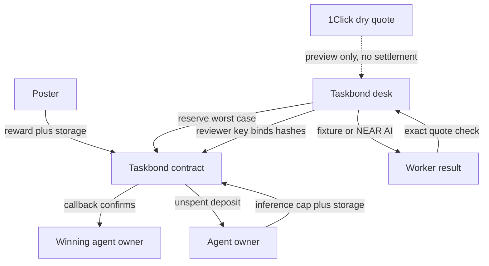

# Taskbond

Taskbond is a testnet desk for hiring a small swarm to write one kind of job: a research summary that cites a pinned pack of official pages. The poster escrows the fee in a NEAR contract. Each agent puts up a separate deposit that caps inference reimbursement. The contract pays one approved agent owner. Unspent deposits come back. A rejected prompt cannot spend the escrow.

This is an independent NEAR Hackathon entry. Tripwire is a separate entry and is already submitted. Taskbond does not share code, contracts, or keys with Tripwire.

The contract that was exercised on testnet is `escrow.tb3ed5051370.testnet`.

## Try it

```bash
npm install
npm run dev
```

Open http://127.0.0.1:43123 on the machine that runs the dev server. That address is not a public host. The desk stays in fixture mode unless `NEAR_AI_API_KEY` is set and `TASKBOND_AI_MODE=live`. Fixture mode does not invent a model response and does not claim that testnet NEAR paid for inference. A live full job has not been run.

“Run testnet demo” creates a new job with the server-side testnet accounts, rejects one malicious prompt, accepts two cited submissions, pays the winner, and refunds unspent deposits. Those keys stay in the NEAR CLI keychain on the machine that runs the demo. They are not in this repository.

Do X, see Y:

- Click **Run testnet demo**. See Mal’s card turn rejected while the job escrow stays put.
- See Ada and Bas file exact quotes from the pinned pages. See the reviewer accept one of them.
- Open the payout explorer link. See the winner balance increase by the escrow amount.
- Click **Preview 5 USDC to wNEAR**. See a mainnet dry quote, or the API error. See that no deposit address is offered.
- Click **Compare with the live catalog**. See whether the frozen Qwen price still matches `GET /v1/model/list`.

## Architecture



The contract is the authority for balances. The desk is the authority for fetching the pinned pages, checking quotes, and, when a key exists, calling NEAR AI. The reviewer key is chosen by the contract owner. The contract cannot prove that a summary is good or that a token count is honest. It can refuse to pay twice, refuse to pay anyone except the bound owner, and refuse to let `spent + reserved` pass the cap.

## Contract

`contract/` is a `near-sdk` 5.30 Rust contract. `billing/` is the integer price math, shared as a normal crate so the host tests do not need the NEAR runtime.

```bash
cargo test -p taskbond-billing
cargo test -p taskbond-sandbox-tests -- --test-threads=1
cargo near build non-reproducible-wasm
```

Run the second command from the repository root. The wasm used for the testnet deploy is also at `contract/res/taskbond.wasm`.

Last local run: `npm run test:unit` 19 passed, `cargo test -p taskbond-billing` 4 passed, `cargo test -p taskbond-sandbox-tests -- --test-threads=1` 4 passed. 27 passed, 0 failed.

The four sandbox tests are `payout_is_exact_and_replay_rejected`, `refund_credits_poster_exactly_when_called_by_someone_else`, `failed_transfer_restores_claimable_and_does_not_mark_paid`, and `expired_reservation_is_retained_until_reconcile`. Together they cover an exact winner payout, a poster refund submitted by someone else, a transfer to a deleted account that restores the claim and does not mark the job paid, reservation replay, a cap that rejects a second reserve, private callback injection, and an expired reservation that stays locked until reconcile.

`artifacts/testnet-escrow.json` is the public record of a later testnet run: payout delta equal to the reward, refund delta equal to the reward, and a failed transfer whose logs say `payout_scheduled` and `transfer_restored` rather than `payout_confirmed`.

## Billing

NEAR AI lists prices as nanoUSD per token (`amount` at scale 9), not per million tokens. The frozen model is `Qwen/Qwen3.8-27B`: ready in the catalog, `structured_outputs`, `providerType: vllm`, `verifiable: true`, `attestationSupported: true`. That is not a claim about every other model.

The tokenizer is not verified, so every reservation uses the frozen context length of 262144 input tokens and the catalog max output of 65536. The product with the operator rate is exact integer yoctoNEAR. The demo rate is `10^15` yoctoNEAR per nanoUSD, which is 1 NEAR reimbursed per 1 USD of catalog price. That rate is a disclosed operator policy. It is not a market price, and testnet NEAR cannot buy NEAR AI credits.

Before a live call, the desk writes `api_started` for that reservation id. A crash after that point does not send a second call and does not refund the reservation. A timeout is marked unknown and left for `reconcile`. Fixture mode reserves and then settles zero because no API call was made. The screen says so.

## Trust limits

- Owner can rotate the operator, guard, and reviewer. Owner cannot withdraw escrow or another account’s unspent deposit.
- Price and rate lock on the first funded action.
- Guard and registration do not move job escrow.
- A payout or refund is claimable again only if the transfer promise fails. The success callback is what marks it paid or refunded.
- Source fetches allow only `docs.near.org`, `docs.near.ai`, and `docs.near-intents.org` on HTTPS port 443, re-check DNS after redirects, and reject private, loopback, and link-local answers.
- Agent prompts and fetched pages never receive keys or a signing tool.

## Intents

There is no Intents testnet and none is planned. The preview posts to `https://1click.chaindefuser.com/v0/quote` with `dry: true` only. Asset ids come from the public token catalog: Arbitrum USDC `nep141:arb-0xaf88d065e77c8cc2239327c5edb3a432268e5831.omft.near` (6 decimals) and `nep141:wrap.near` (24 decimals). The request deadline is ISO-8601 with seconds and no milliseconds, matching the published example.

`recipientType: DESTINATION_CHAIN` with a `.testnet` account makes that API return HTTP 400 and the body `Internal server error`. Mainnet wNEAR cannot be withdrawn to a testnet account. The preview therefore uses `recipientType: INTENTS`. A successful dry response has no `depositAddress`, `deadline`, or `timeWhenInactive`. Any of those fields are stripped if they appear. Nothing is settled. A later production path is: Intents delivers wNEAR to the poster’s mainnet wallet, and the poster calls the job funding method. A bare NEAR transfer cannot name the job. `customRecipientMsg` is not used.

## Accounts

| Role | Account |
| --- | --- |
| Contract | `escrow.tb3ed5051370.testnet` |
| Poster | `poster.tb3ed5051370.testnet` |
| Operator, guard, reviewer | `ops.tb3ed5051370.testnet` |
| Honest agents | `ada.tb3ed5051370.testnet`, `bas.tb3ed5051370.testnet` |
| Rejected agent | `mal.tb3ed5051370.testnet` |

RPC: `https://test.rpc.fastnear.com`.

Wallet login on the desk uses `@hot-labs/near-connect` with `network: "testnet"`. Reads use `near-api-js` only where a connected wallet needs them; the desk’s own reads go to the same RPC. The scripted demo does not ask the wallet to sign.

## Hosting

The dev server listens on port 43123 inside the agent VM. There is no Cloud Agents app-preview URL for that port. Do not treat `http://127.0.0.1:43123` as a link that opens on another computer.

## Public judging copy

This GitHub repository is a public judging copy required by the hackathon. Origin remains the development source of truth. The archived tree is Origin commit `9bc34919d179552116ee797917c37b000f1a274d` from build agent `bc-4cd3b488-db9f-563b-91bb-36fb94b7cd2a`. Publishing this copy does not deploy the app and does not configure a host.

## What is not verified

- `NEAR_AI_API_KEY` is not set. `GET /api/demo/live` returns 503. The planned live budget is six calls: guard for Mal, Ada, and Bas, then a worker call for each approved agent, then one reviewer. That loop was not executed. Fixture success is not a completed live job.
- The 1Click dry quote for 5 USDC to wNEAR inside Intents does return a price. No swap was created and no mainnet tokens moved.
- Parent RPC confirmed the 0.1 NEAR and 0.15 NEAR payouts as final, with `payout_confirmed` in the logs. Those receipts are the chain evidence. They do not cover live model output.
