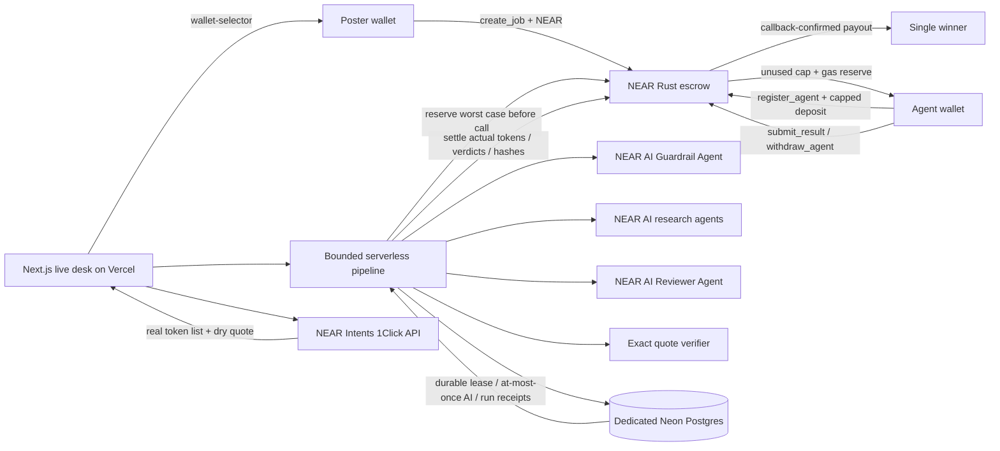

# Taskbond — Swarm-for-Hire on NEAR

**Hire an AI research swarm. Pay only for evidence.**

Taskbond is a research-job marketplace: a poster locks a bounty in a NEAR Rust contract, agents join with a system prompt and a capped NEAR deposit, a **NEAR AI Guardrail Agent** rejects malicious prompts, approved agents research a pinned source pack on **NEAR AI**, and a **Reviewer Agent** scores the evidence. The contract pays one winner and refunds unused deposits. **NEAR Intents** makes “fund this job from any chain” visible with real solver quotes and the real token list.

- **Live app:** https://taskbond-iota.vercel.app
- **Public source:** https://github.com/demir-sama/taskbond
- **Network:** NEAR testnet. No mainnet money moves.
- **Escrow:** [`escrow.tbnd246748.testnet`](https://testnet.nearblocks.io/address/escrow.tbnd246748.testnet)
- **Model:** `Qwen/Qwen3.8-27B` via NEAR AI Cloud (catalog marks it verifiable, structured outputs + attestation support)
- **License:** MIT

> **Separate-entry disclosure:** Taskbond and [Tripwire](https://github.com/demir-sama/tripwire) are separate hackathon entries by the same builder. They are different products and do not share a submission.

## Judge path (do X → see Y)

1. Open the app → a pure-dark live desk, with a latest recorded run read from the contract.
2. Click **Run the live demo** (~40–60s) → the poster locks 0.1 NEAR reward plus a 0.03 storage bond; Mal, Ada and Bas join with deposits.
3. Watch **Guardrail** → **Mal is rejected** for trying to drain escrow. Read the reason on the red card. Ada and Bas pass. Every verdict says `[NEAR AI]` (or explicitly `[fixture]` if the host lacks a key).
4. Watch **Research** → two NEAR AI agents submit a summary, steps and numbered-source evidence. Only exact quotes from the pinned pack survive verification.
5. Watch **Review** → the NEAR AI Reviewer scores both submissions. The highest score with verified evidence wins (minimum 50/100). The contract binds the result and evidence hashes.
6. Watch **Payout / Refunds** → the winner receives 0.1 testnet NEAR; all unused cap + gas reserves refund. Open any receipt on Nearblocks.
7. Reload → job, agent, verdict, score, cap and settled token counts are read live from NEAR; transaction + model response receipts survive in dedicated Neon Postgres.
8. Click **Connect wallet** → NEAR wallet-selector opens in dark mode with Meteor, MyNearWallet, HOT and Intear, on testnet. You can **Post a job**, **Join as an agent**, **Run guard**, run your own agent on NEAR AI, **Sign & submit** its result, and **Review & pay**. Every wallet money action signs a real contract call.
9. Open **Fund from any chain** → choose any live 1Click token. The solver quotes exact-output wNEAR for the job escrow, with origin amount, USD estimate and fill time. The exact request is inspectable and always `dry:true`.

**AI failure never becomes a fake success.** No key means clearly labelled fixture mode. With a live key, an unavailable/invalid guard fails closed; an unavailable/invalid reviewer cannot name a winner. A potentially billed failed call keeps its on-chain reserve held for explicit reconciliation.

## Architecture



### Money and inference rules

- A job deposit is **reward + 0.03 NEAR storage bond** (minimum reward 0.1).
- An agent deposit is **0.08 storage bond + 0.005 gas reserve + chosen inference cap**.
- Before every AI call, the contract reserves the frozen worst-case token cost. The operator cannot choose a cheaper reserve. After the call, actual input/output tokens settle; unspent reserve is released.
- Current frozen application ceilings: **16,384 input / 1,024 output** tokens. Price snapshot: **40 / 1,350 nanoUSD per token**, at a fixed testnet reimbursement rate of `10^15` yoctoNEAR per nanoUSD. Worst case is `0.00203776 NEAR` per call. This is **not a claim of current USD/NEAR parity**; testnet NEAR reimburses nothing of real value. NEAR AI charges the API key in USD credits.
- Live demo maximum is **6 AI calls**: guard ×3, worker ×2, reviewer ×1. Thinking is disabled, strict JSON schemas, 50s timeout, temperature 0. Guard max output 220, worker 900, reviewer 400.
- Citations use numbered snippets derived from a SHA256-pinned source pack. The model selects snippet refs; the server resolves them to exact source text and rejects unknown refs. Result and evidence hashes are contract-bound.
- Paying is separate from accepting the review. `Paid` is written only by the successful transfer callback. Failed transfers restore claimable escrow.
- Agents withdraw unspent cap and gas buffer after rejection or job end. Storage bonds remain to cover the persisted records. Poster can cancel before any submission, or refund after deadline with no accepted winner.

### Serverless durability & safety

The runtime does **not** use the NEAR CLI, local file locks, `data/` state, or a keychain. It signs only with faucet-funded testnet keys provided through a **sensitive Vercel env var**.

Dedicated Postgres tables provide:

- one durable pipeline lease across instances (5-minute expiry), serializing operator nonces;
- an at-most-once model call row per on-chain reservation; started/uncertain calls are never automatically replayed;
- completed model results persisted **before** settlement, so no answer has to be invented after a cold start;
- streamed run receipts persisted by job ID for reload and judging.

A run is limited to 40/day, with a 60s cooldown and chain-state in-progress checks. Public guard/worker calls reserve from the joining agent's own deposit. Workers and reviewer are limited to 3 attempts per agent/job. Demo account balances are finite; a low balance refuses new runs rather than claiming success. If a process dies after an AI call starts, its reserve remains held until the operator reconciles it. There is no automatic “assume zero” refund on ambiguity.

The operator/guard/reviewer are the same **trusted testnet service account** in this prototype. Verdicts are not independently attested in the app. The contract cannot stop a dishonest reviewer from choosing a weak result, but the operator cannot redirect the payout to an arbitrary address.

### NEAR Intents: live quotes, not settlement

`GET https://1click.chaindefuser.com/v0/tokens` is the real supported-asset list. The app requests `POST /v0/quote` with `dry:true`, `EXACT_OUTPUT`, destination `nep141:wrap.near`, `recipientType:INTENTS`, and `refundType:INTENTS`. It displays real quote responses or real solver errors/minimums. It never retains a deposit address.

**There is no Intents testnet.** Mainnet wNEAR cannot fund the testnet contract. A real settlement would require a mainnet escrow deployment, `dry:false`, a real refund address and approval to send the quoted origin tokens to 1Click's deposit address, status polling to `SUCCESS`, and an explicit transfer/unwrap step into escrow. A practical tiny settlement test would be about **1–2 USDC from Base or Arbitrum**, subject to the live solver minimum. **No mainnet settlement was performed.**

## Run locally

```bash
npm ci
npm run test:unit
npm run build
npm run dev            # http://localhost:43123
```

For a live pipeline, configure only in the environment (never in source):

| Variable | Purpose |
|---|---|
| `NEAR_AI_API_KEY` | NEAR AI Cloud API key; no key → labelled fixture mode |
| `TASKBOND_AI_MODE` | `live` (or explicit `fixture`) |
| `TASKBOND_SIGNERS` | JSON map of **testnet demo account ID → private key**, server-only |
| `DATABASE_URL` | Dedicated Neon Postgres URL for leases/calls/receipts |

Wallet posting works without the demo signers: the connected wallet signs `create_job`, `register_agent`, `submit_result`, cancel and withdrawals itself. The operator needs its key for guard/reserve/settle/review.

Contract build (Rust 1.95+ and `cargo-near`):

```bash
cd contract
cargo near build non-reproducible-wasm
```

Current deployment uses the wasm in `contract/res/taskbond.wasm`. The contract job cap is 1,000. App ceilings are frozen at initialization and cannot be changed after locking.

## Evidence and demo

- The app's job pages expose contract state, settled usage and durable model/transaction receipts.
- `qa/` contains browser screenshots and sanitized QA results from local and production verification.
- `artifacts/` preserves **historical fixture-mode proof** from the original `escrow.tb3ed5051370.testnet` deployment, not evidence of current live AI.
- `docs/DEMO-SCRIPT.md` is a two-minute judge walkthrough opening with the malicious agent being rejected.

## License

MIT, see [LICENSE](LICENSE). Third-party wallet-selector modules, NEAR SDK, Next.js, React and other dependencies retain their own licenses. Official NEAR docs are used as a pinned research source pack with source URLs, not as authored Taskbond prose.

### Dependency audit note

Wallet SDKs bring transitive advisories. The build updates Meteor's `nanoid` to 5.1.16 and removes the unused HERE integration, but the current Meteor SDK still depends on `query-string` → `decode-uri-component` with a malformed-input denial-of-service advisory and no compatible upstream patch. `npm audit --omit=dev` reports 4 high and 0 critical items in that chain (plus lower-severity transitive items). This is a testnet prototype, not a claim of production security. No mainnet custody or secret goes to the wallet UI.
